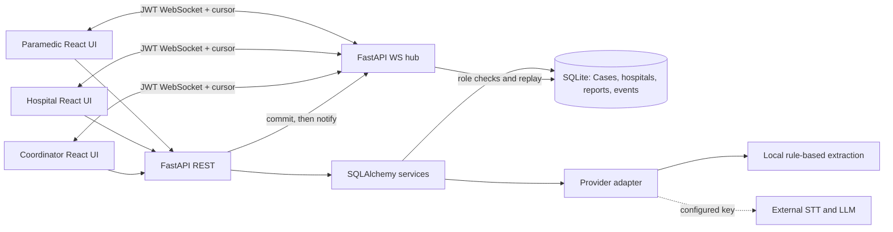

# Architecture and Data Flow



## Repository

```
AyuStream_AI/
  backend/
    app/{main,db,models,schemas,core,ai,live,routes_cases,routes_coordination,routes_ops,seed}.py
    tests/{conftest,test_workflow}.py
    requirements.txt
  frontend/
    src/components/       shared shell and status components
    src/lib/              API, role-aware session and WebSocket client
    src/pages/            case flow, hospital coordination, analytics, simulator
    package.json
  docs/                   architecture, API, security and test results
  scripts/package.py
  README.md, PROJECT_STATUS.md, DEMO_GUIDE.md, WEBSOCKET_EVENTS.md
```

## Model relationships

- **User** → Hospital (optional): hospital staff scoped to one receiving hospital, other roles global or owner-based.
- **Case** → User creator, intended Hospital, confirmed Hospital; generated unique `AYU-{year}-{random}` ID and `TMP-...` patient identifier.
- **Report** → Case: immutable transcript input, provider label, schema-validated summary JSON, review status. A human review stores a corrected summary (original transcript preserved).
- **Observation** → Case: reported manual value, unit, source and timestamp.
- **Conflict** → Case: two retained values, source labels and human resolution.
- **Acceptance** → Case and Hospital: distinct pending, accepted and declined decision with timestamps, actor IDs and optional escalation timestamp.
- **DestinationChange** → Case: prior and confirmed hospital, responsible actor and reason.
- **Resource** → Hospital: availability, optional assigned Case. `ResourceAction` preserves transitions.
- **Event** → Case/Hospital when applicable: persisted immutable event, auto-increment sequence, sanitized payload and actor.
- **Ack** → Event and User: unique per recipient and event.

SQLite foreign keys are enabled, and resources use a conditional SQL `UPDATE WHERE state='available'` to ensure at most one successful reservation. Cases, reports, and destination actions are not keyed to patient names. Backend role authorization is re-evaluated on each REST request and on WebSocket event delivery.

## Workflow

1. User signs in with a seeded demo account to obtain a JWT.
2. Paramedic creates an emergency case; DB commits case and `case.created` event, then broadcasts the event.
3. Paramedic submits reported text. The provider adapter extracts stated information. Pydantic validates the summary. DB persists the report and a clinical event.
4. Human verifies the structured summary or adds observations. Conflicting reported measurements create a persistent conflict record.
5. Coordinator queries rules-based SmartRoute matching. Missing required capabilities and `unable`/`unreachable` readiness are excluded. A stale readiness flag is surfaced separately. No travel time is invented.
6. Coordinator requests explicit hospital acceptance. Receiving hospital responds accepted or declined. A timeout escalates but cannot accept.
7. Coordinator confirms destination using an accepted request. Ambulance and authorized hospital clients receive the persisted event.
8. Client ACKs event receipt; new sessions replay events after a saved cursor.

## Local threat model

The platform is explicitly not deployed to real emergency environments. A local browser token in storage and WebSocket URL is convenient for demos but not secure enough for patient records. Missing capabilities include production authentication lifecycle, secure PHI storage, distributed event delivery and monitored failover. Use HTTPS and a production architecture review before considering deployment, and never treat this as clinically validated.
